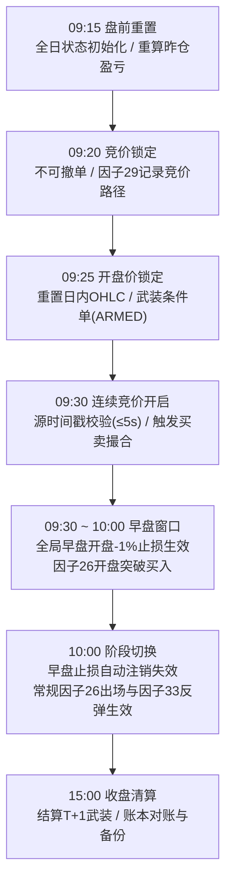

# myquan 全局量化交易策略说明手册

> **版本**：2026-11-05 生产标准版  
> **适用范围**：实盘盯盘（`holdingStocks/index.py`）、多策略账本运行时（`strategy_books_runtime.py`）、离线回测与策略验证引擎。

---

## 目录
- [一、 体系架构与设计原则](#一-体系架构与设计原则)
- [二、 股票宇宙与监控池分层](#二-股票宇宙与监控池分层)
- [三、 日内交易全时序管线](#三-日内交易全时序管线)
- [四、 入场买入规则（Entry Rules）](#四-入场买入规则entry-rules)
- [五、 全局出场规则与优先级（Exit Rules）](#五-全局出场规则与优先级exit-rules)
- [六、 资金与仓位管理规则（Capital V2）](#六-资金与仓位管理规则capital-v2)
- [七、 监控预警与微信通知机制](#七-监控预警与微信通知机制)

---

## 一、 体系架构与设计原则

本项目基于 **AKQuant** 量化回测与实盘盯盘体系构建，遵循 **Realtime First（行情事件驱动）** 原则：

1. **核心逻辑解耦**：
   - **行情层**：东财 SSE + 新浪多源并发轮询，分层推送，延迟严格控制在秒级/毫秒级。
   - **决策层**：`quote_exit.py` 与 `strategy/exit_rules/` 纯函数无状态计算，统一出场决策逻辑。
   - **执行与账本层**：`holdingStocks/index.py` 与 `strategy_books_runtime.py` 驱动 MySQL 数据库与纸面多策略账本。
   - **展示与交互层**：轻量 Web 看板（`watch-ui` / 8765 端口）+ 微信实时告警通知。
2. **多策略账本并行**：
   - **策略一·援军战法（strategy1）**：侧重分时多阶段买入（竞价因子29、开盘突破因子26、低点反弹因子33），精细化捕捉日内弹性。
   - **策略十六·核心龙头（strategy16）**：以因子27选拔的30只核心龙头池为底仓宇宙，依托因子26开盘限价突破买入，严格执行风控。
   - 各策略拥有隔离的虚拟现金、持仓与成交事件，同时底层共享一套稳健的**全局出场风控引擎**。

---

## 二、 股票宇宙与监控池分层

系统采用多级分层池设计，确保在数百只股票的监控规模下仍能保持毫秒级的交易响应：

| 池类别 | 标的构成 | 刷新频率 | 承担职责 |
| :--- | :--- | :---: | :--- |
| **热池（Active Watchlist）** | 实际持仓 + 当前默认策略池 + 公共自选池（天通/凯盛/东材/金安），硬帽 ≤ 48 只 | 约 0.4s ~ 1s 快刷 | 全量运行买卖信号判定、条件单撮合、四槽管理、即时微信告警 |
| **公共自选池（Self Watchlist）** | 600330（天通股份）、600552（凯盛科技）、601208（东材科技）、002636（金安国纪） | 与热池同步 | 全策略共享底池，常驻监控与入槽候选 |
| **因子27 核心龙头池** | 每季度轮动刷新的 30 只核心板块龙头股票（剔除 ST、百元股、科创/创业板） | 与热池同步 | 策略十六默认交易宇宙 |
| **观察底池（Extended Watchlist）** | 紫阳真君等扩展观察池（100 ~ 500+ 只） | 约 3s/轮 分块轮询 | 仅提供看板现价与涨跌幅轻量展示，不占实时撮合与信号通道 |

---

## 三、 日内交易全时序管线

系统严格按照 A 股交易时间轴驱动日内状态机流转：

- **09:15 前**：盘前准备，不触发任何交易信号，日内涨跌幅展示沿用前一日收盘数据。
- **09:15 ~ 09:25**：集合竞价阶段，9:15 执行里程碑重置；指示价格仅供展示，**严禁**作为买卖基准或止损结算。
- **09:25 ~ 09:30**：开盘价锁定，系统核定各标的开盘买点与止损价，武装条件单（`ARMED`），允许挂单，**不**结算成交。
- **09:30 ~ 10:00（早盘防错杀窗口）**：**全局早盘止损规则生效**。开盘若有低开洗盘，不盲目市价割肉，以开盘价下方 1% 作为底线防守。
- **10:00 ~ 15:00（常规交易窗口）**：早盘附加止损自动失效，系统完全转入常规多层止盈与硬止损接管。

---

## 四、 入场买入规则（Entry Rules）

### 1. 因子26 开盘突破买入（全策略通用基石）
- **买点计算**：以当日正式开盘价为基准：
  $$\text{买点} = \lceil \text{open} \times (1 + \text{entry\_pct}) \rceil$$
  （主板普通阈值通常为 $+2.5\%$，策略十六依据 `thr_2026.json` 针对个股择优匹配 $2\% / 2.5\% / 3\%$）。
- **过门过滤条件**：
  1. **K线形态**：前一交易日必须为阴线或小阳线（涨幅 $< 3\%$）；
  2. **防过热禁买**：禁止出现跨日双阳累计涨幅 $\ge 5\%$；
  3. **竞价涨停防追高**：主板正式开盘较昨收上涨 $\ge 9.7\%$ 时禁买（创业板/科创板为 $\ge 19.7\%$）。
- **成交确认**：必须收到 $\ge 09:30:00$ 且源延迟 $\le 5\text{s}$ 的新鲜行情，当日最高价或现价触及买点即按条件买入。

### 2. 因子29 竞价末段买入（策略一专选）
- 在 09:20 ~ 09:25 独立监测竞价资金抢筹异动；
- 09:25 生成买入意向，并在 09:30 首笔有效正式开盘行情复核无误后，以开盘价模拟撮合成交（早盘限新买 1 只）。

### 3. 因子33 日内低点反弹买入（策略一 10:00 后专选）
- 10:00 之后不再追高开盘突破，转为关注日内探底回升；
- 目标买入价根据当日即时动态最低价上浮个股阈值计算：
  $$\text{买点} = \lceil \text{day\_low} \times (1 + \text{threshold}) \rceil$$

---

## 五、 全局出场规则与优先级（Exit Rules）

出场规则在 [`holdingStocks/quote_exit.py`](file:///Users/wangxiangyu/Documents/myquan/holdingStocks/quote_exit.py) 中统一定义，**对所有策略的隔夜持仓全局生效**。

出场判定优先级如下：

### 1. T+1 与状态安全拦截（最高优先）
- 当日新买入持仓（`buy_time >= today`）受 T+1 规则限制，**禁止执行平仓**（仅在盘中触碰成本硬止损线时预先标记 `stop_noted`，为次日武装）。
- 遭遇跌停锁死（跌停价无买盘）或人工手动锁仓（`hold_locked`）时，拦截出场。

### 2. 【核心】全局早盘开盘-1%止损（09:30 ~ 10:00 窗口期）
> **上线时间**：2026-11-05 正式升级为全局规则。
- **触发条件**：当前时间处于 `09:30:00` 至 `10:00:00` 前，且当前有效现价：
  $$\text{last} \le \lfloor \text{open} \times 0.99 \rfloor$$
- **执行动作**：立即清空可卖仓位，按即时触发价格成交，标记理由为 `s1_morning_open_stop` / `morning_drop_1pct_stop`。
- **设计初衷与实战效果**：
  - 彻底改变以往 09:30 集合竞价低开直接被开盘保护“一刀切”强平在全天最低点的缺陷；
  - 赋予隔夜仓在早盘 30 分钟内博弈反弹的空间（如 10-29 润建股份、11-05 天通股份反弹大涨）；
  - 若主力反弹乏力、顺势破位下杀超过 1%，则果断止损离场，锁死单边暴跌风险。两周回测超额达 $+1.05\% \sim +1.51\%$。
- **时效性**：**10:00:00 整点自动失效**，不沿用 10:00 前的低点补杀。

### 3. 成本硬止损（Hard Stop）
- **触发条件**：实时现价触及成本下方 $2.5\%$：
  $$\text{last} \le \text{cost} \times (1 - 0.025)$$
- **执行动作**：无论何时（全天连续竞价），触及立即全清，坚决防守本金底线。

### 4. 隔夜回落保护（Overnight Trail）
- **触发条件**：买入日收盘浮盈 $< 3\%$ 并已标记隔夜保护者，次日参考隔夜峰值（`overnight_peak`）回落 $2.5\% \sim 3\%$；
- **底线保证**：保护价决不低于成本硬止损线。

### 5. 中段止盈（Half Gain & Volatility Trail）
- **适用区间**：持仓峰值浮盈在 $+3\%$ 至 $+10\%$ 之间；
- **触发条件**：现价触碰以下两条动态防守线中的**较高者**时全清：
  1. **利润回吐线**：从峰值浮盈回吐 $50\%$ 的利润；
  2. **波动率防守线**：从峰值价格回落 $0.5 \times \sigma_{20\text{d}}$（近20个交易日日收益波动率）。

### 6. 高位阶梯止盈（Ladder Profit Taking）
- **$+10\%$ 阶梯（减半保本）**：持仓浮盈首次触及 $+10\%$ 时，按整手卖出 $50\%$ 仓位（不足 200 股全清），锁定胜果并转入完全被动防守；
- **$+15\%$ 阶梯（大赢全清）**：持仓浮盈进一步触及 $+15\%$ 时，全清剩余仓位；
- **冲高回落清仓**：持仓浮盈曾冲过 $+10\%$ 但未达 $+15\%$ 时，若从历史最高峰值回落超过 $2\%$，立即全清余仓。

---

## 六、 资金与仓位管理规则（Capital V2）

系统采用机构级的严密风控纪律，防止单票重仓与过度交易：

1. **总持仓槽位限制**：
   - 物理持仓上限最多 **5 只**（仅对实际持股 `qty > 0` 计数）。
2. **单日新开额度硬控制**：
   - 每个交易日最多新开买入 **2 只** 标的；
   - 额度基于当日真实 BUY 流水重建，盘中平仓释放总持仓槽位，但**绝不恢复**当日新开额度。
3. **单票仓位上限**：
   - 单只股票入场目标市值 $\le$ 当前账户总权益的 **$20\%$**。
4. **可用现金约束**：
   - 每一笔委托严格受实时可用现金约束，**严禁负现金买入，严禁同股盘中追加加仓**。
5. **撮合顺序原则**：
   - **先平后买**。同一轮次扫描中优先执行卖出平仓释放资金与槽位，再评估新买入候选。
6. **当日卖出禁再买规则**：
   - 当日止损或已触发平仓的标的，当日严禁再次买入。
   - *（策略十六特例：前日止损已记、次日竞价低开被早盘止损/开盘保护全清后，当天若盘中再次放量突破买点，允许回补，但仍受单日新开额度约束）*。

---

## 七、 监控预警与微信通知机制

1. **微信推送以严格策略信号为准**：
   - 微信通知通道与盯盘前台展示解耦，推送严格对齐底层策略引擎的真实成交/止损信号。
2. **单日防抖去重机制**：
   - 系统按 `[日期 + 股票代码 + 信号类别]` 维度在 MySQL（`wechat_alert_state.first_alerts`）中严格仅持久化首笔记录；
   - 价格反复震荡横跳、离开警戒区后重返、同日重启进程等场景均**不重复发送**，彻底杜绝日内消息轰炸。
3. **安全与行情时效复核**：
   - 任何涉及模拟撮合或买卖推送的行情，必须通过 $\le 5\text{s}$ 的新鲜度校验，开盘价必须经过单股独立接口一致性复核，防止因网络闪断、竞价虚高产生误报。

---

*文档维护说明：本文件为项目全局交易规则权威说明，任何因策略优化、参数调优或新增因子引起的行为变动，须同步修订本文档及 `holdingStocks/README.md`。*
