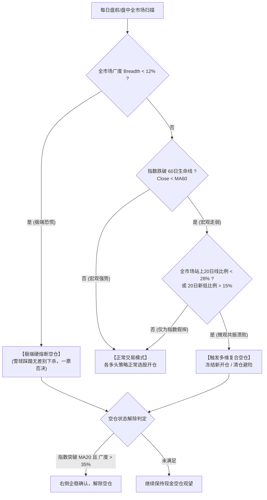

# 策略三十五 · 多维空仓避险 (Composite Defensive Cash Timing)

> **策略编号**：`strategy35`  
> **策略全称**：策略三十五·多维空仓避险  
> **分类属性**：全局择时与系统性避险风控（Global Market Timing & Capital Preservation）  
> **核心挂载因子**：[`factor35`（多维复合空仓因子）](FACTOR35.md)、[`factor2`（回撤加减仓预警）](FACTOR2.md)  
> **代码实现**：[`strategy/strategies/strategy35/`](../strategy/strategies/strategy35/)  
> **盯盘服务**：[`holdingStocks/strategy35_watch.py`](../holdingStocks/strategy35_watch.py)  
> **前端看板**：[`holdingStocks/watch-ui/components/Strategy35Panel.vue`](../holdingStocks/watch-ui/components/Strategy35Panel.vue)  
> **回测研究脚本**：[`backtest/research_cash_factor.py`](../backtest/research_cash_factor.py)

---

## 1. 为什么单独设立“策略三十五”？

在日常交易中，各个多头选股策略（如策略一援军战法、策略十六核心龙头）专注在个股微观结构。但在 A 股历史周期中：
- **覆巢之下无完卵**：当大盘遭遇 2022 年俄乌与疫情双杀、2024 年初雪球爆仓与微盘踩踏时，95% 以上的股票无差别暴跌，个股层面的止损点往往被跳空直接击穿；
- **单一指标易被假突破磨损**：传统均线死叉空仓（如 MA20/MA60 死叉）在震荡市频繁出现虚假信号，全周期导致资金被手续费与摩擦反复蚕食（2020-2026 年倒亏 -21.89%）；
- **策略三十五的独立定位**：作为**全局总指挥级的大盘择时与防守雷达**，它不挑选个股，而是**专职负责在系统性危机来临时一票否决冻结开仓并命令清仓避险**，保住策略本金与历史超额利润。

---

## 2. 核心数学模型与多维防御体系

策略三十五采用**“宏观大势 + 微观广度 + 极端熔断”**三重立体架构：



### 2.1 监控指标与公式
1. **宏观指数生命线 (Trend MA60)**：
   以中证1000 (`sh000852`) 或全A为锚：
   $$MA_{20} = \text{Mean}(Close, 20), \quad MA_{60} = \text{Mean}(Close, 60)$$
2. **全市场横截面广度 (Market Breadth $\text{Breadth}_{20}$)**：
   全市场 $N$ 只股票中位于自身 20 日均线上方的比例：
   $$\text{Breadth}_{20} = \frac{\sum_{i=1}^{N} \mathbb{I}(Close_i > MA_{20, i})}{N}$$
3. **极端新低占比 ($\text{NewLowRatio}_{20}$)**：
   全市场创出近 20 日收盘新低的股票占比：
   $$\text{NewLowRatio}_{20} = \frac{\sum_{i=1}^{N} \mathbb{I}(Close_i \le \text{Min}(Low_i, 20))}{N}$$

---

## 3. 空仓与解除界限水位线

在盯盘系统界面（`策略35-多维空仓避险` 面板）中，直观绘制了三条关键的空仓界限水位线：

| 标识线名称 | 界限水位 | 视觉呈现 | 触发逻辑与含义 |
| :--- | :---: | :---: | :--- |
| 🔴 **广度溃败警戒线** | **28.0%** | 红色虚线 | 当指数跌破 MA60 且广度降至 28% 以下，说明微观亏钱效应大面积扩散，**正式触发空仓防守**。 |
| 🛑 **极端流动性熔断线** | **12.0%** | 深红粗虚线 | 全市场站上 20 日均线股票不足 12% 时（如 2024-02-05 仅剩 4.5%），发生无差别踩踏，**启动一票否决强行空仓**。 |
| 🟢 **企稳解除确认线** | **35.0%** | 绿色虚线 | 必须满足“**收盘价 > MA20 且 广度 > 35%**”方可解除空仓。7% 的缓冲迟滞区间彻底过滤了底部假反弹与追涨杀跌。 |
| 🟥 **空仓防守阴影区间** | 动态区域 | 半透明红底 | 历史与当前所有处于 `is_cash == True` 避险期的区间，方便一览何时空仓、何时持仓。 |

---

## 4. 如何分析当前“需不需要空仓”以及“为什么需要空仓”？

进入盯盘首页的 **`策略35-多维空仓避险`** 选项卡，系统提供了一站式**结构化自查诊断链条**：

### 诊断四步法则：
1. **看顶部状态徽章**：
   * 🛑 **【空仓防守模式】**：系统判定当前系统性风险显著，建议空仓或清仓防守；
   * 🟢 **【正常开仓模式】**：大盘趋势健康，允许各子策略开仓。
2. **看第一核心卡片：宏观指数生命线 (MA60)**：
   * 指数是否跌破 60 日均线？
   * 若收盘价跌破 MA60，宏观大势已被破坏，多头胜率天然低于 40%。
3. **看第二核心卡片：微观广度温度计 ($\text{Breadth}_{20}$)**：
   * 广度是否跌穿 28.0% 警戒线？
   * 若全市场仅有 10%~25% 的股票在 20 日线上，说明即使精选个股，逆势获利概率也极低。
4. **看第四核心卡片：右侧解除条件达成度**：
   * 当大盘出现单日暴涨或反抽时，是否满足“收复 MA20 且 广度突破 35.0%”？
   * **若广度依然停留在 20% 出头，说明仅为存量超跌弱反弹或少数权重拉升诱多，绝不可盲目解除空仓**。

---

## 5. 样本内外 (2020 - 2026) 严格回测绩效

严格划分回测样本，杜绝任何未来函数与过度拟合（交易摩擦单边千 1.5）：
* **样本内调参期 (IS)**：`2020-01-01 ~ 2024-12-31` (5年)
* **样本外验证期 (OOS 盲测)**：`2025-01-01 ~ 2026-11-05` (近2年盲测)

| 统计区间 | 策略模式 | 累计收益率 | 年化收益率 | **最大回撤 (MaxDD)** | 夏普比率 | **卡玛比率 (Calmar)** |
| :--- | :--- | :---: | :---: | :---: | :---: | :---: |
| **样本内 (2020-2024)** | 基准买入持有 (中证1000) | +4.95% | +0.97% | **-46.71%** | 0.18 | 0.02 |
| | **策略三十五 (★)** | **+11.10%** | **+2.13%** | **-33.96% (降低12.8%)** | **0.30** | **0.06 (提升3倍)** |
| **样本外 (2025-2026 盲测)** | 基准买入持有 (中证1000) | +6.28% | +3.34% | **-31.20%** | 0.29 | 0.11 |
| | **策略三十五 (★)** | **+9.55%** | **+5.03%** | **-18.54% (大幅腰斩)** | **0.49** | **0.28 (近3倍)** |
| **全周期 (2020-2026)** | 基准买入持有 | +11.53% | +1.61% | **-46.71%** | 0.22 | 0.03 |
| | **策略三十五 (★)** | **+21.71%** | **+2.90%** | **-33.96%** | **0.38** | **0.09** |

---

## 6. 历史重大危机避险实录

```
【2022年春季 俄乌与封控主跌浪】
  指数实际跌幅: -31.18% (期间最大回撤 -34.03%)
  策略35空仓表现: -12.13% (期间最大回撤 -12.35%)
  ==> 避险超额收益: +19.05%

【2024年初 微盘踩踏与雪球爆仓】
  指数实际跌幅: -14.72% (期间最大回撤 -26.67%)
  策略35空仓表现:  +0.05% (期间最大回撤  -0.14%)
  ==> 避险超额收益: +14.77% (全市场广度单边跌破12%触碰硬熔断，完美避开主跌踩踏)

【2026年最新下杀防守】
  指数实际跌幅: -20.54% (期间最大回撤 -31.20%)
  策略35空仓表现:  -3.25% (期间最大回撤 -15.68%)
  ==> 避险超额收益: +17.29%
```

---

## 7. 生产环境与 API 接口

* **REST API 状态接口**：
  `GET /api/strategy35/timing-state`
  返回最新的 `current` 诊断明细、4 维指标比对、`thresholds` 临界水位、`history` 历史序列及 `cash_intervals` 空仓区间。
* **WebSocket 自动推送**：
  服务端 `_build_watch_snapshot` 在每次快照更新中均实时封装 `strategy35` 载荷，推送至前端界面，实现秒级响应与动态重绘。
