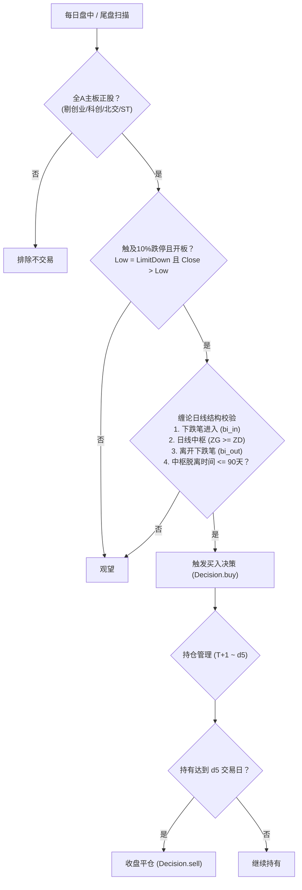

# 策略三十七：跌停开板缠论反转策略 (Limit-Down Open-Board Chan Reversal Strategy)

> 状态：生产可用（Production Ready）  
> 责任模块：[`strategy/strategies/strategy37/`](file:///Users/wangxiangyu/Documents/myquan/strategy/strategies/strategy37/)、[`strategy/factors/factor37.py`](file:///Users/wangxiangyu/Documents/myquan/strategy/factors/factor37.py)  
> 回测研究：[`scripts/run_limit_down_chan_research.py`](file:///Users/wangxiangyu/Documents/myquan/scripts/run_limit_down_chan_research.py)  
> 核心产物：[`reports/limit_down_chan/`](file:///Users/wangxiangyu/Documents/myquan/reports/limit_down_chan/)  
> 绑定因子：[因子37：跌停开板缠论反转因子](file:///Users/wangxiangyu/Documents/myquan/strategy/factors/factor37.py)  

---

## 1. 策略定位与研发背景

### 1.1 核心逻辑：极端情绪出清 + 缠论中枢背驰
在 A 股主板市场中，个股出现跌停往往是空头动能最剧烈释放的时刻。然而，若个股是在**日线级别经历了“下跌笔进入 $\to$ 完整中枢震荡 $\to$ 离开下跌笔”**的充分杀跌后出现跌停，并且盘中有主力承接资金介入**撬开跌停板（最低价=跌停价，收盘价>最低价）**，这通常标志着该级别的趋势背驰段成立、恐慌盘已一次性出清，极易引爆强劲的反弹反转。

### 1.2 严格的三大交易边界
1. **全 A 主板限定**：聚焦沪深主板（600/601/603/605/000/001/002/003），剔除创业板、科创板与北交所；
2. **买入当时非 ST**：严格排除 ST / *ST 股票（主板正股常规跌停幅为 10%，ST 为 5%）；
3. **离开中枢时间约束**：从中枢离开到跌停发生日在指定时间窗口内（调参锁定 90 天/3 个月最优）。

---

## 2. 策略架构与决策流程



---

## 3. 实证回测、调参与验证结果

基于全 A 沪深主板 843 只标的，跨越 2020 至 2026 年近 7 年全市场数据：

### 3.1 阶段一：2020-2023 样本内回测（交易数 1,133 次）
- **触及跌停撬板买入**：
  - **d1（次日）胜率 67.26%**，平均收益 **+3.03%**，盈亏比 **4.01**；
  - **d5 累计收益 +3.78%**，胜率 59.40%，盈亏比 2.56。
- **收盘价买入**：
  - 尾盘开板确认买入，日内反弹已被部分消化，d1 均收益 -0.17%，持有至 d5 均收益转为 **+0.58%**。

### 3.2 阶段二：2023-2025 调参区间（对比 1个月 vs 2个月 vs 3个月）
| 调参时间窗口 | 交易笔数 | d1 胜率 | d1 均收益 | d5 胜率 | d5 均收益 | d5 盈亏比 |
| :---: | :---: | :---: | :---: | :---: | :---: | :---: |
| 1个月 (30天) | 460 | 53.48% | +0.22% | 50.43% | +1.97% | 1.61 |
| 2个月 (60天) | 587 | 55.54% | +0.52% | 56.05% | +3.84% | 2.26 |
| **3个月 (90天)★最优** | **623** | **56.02%** | **+0.60%** | **57.78%** | **+4.21%** | **2.43** |

### 3.3 阶段三：2025-至今 样本外 OOS 验证（858 次交易）
采用 3 个月最优参数，在全新样本外行情中：
- **d1**：胜率 53.38%，平均收益 +0.28%，盈亏比 1.14
- **d3**：胜率 51.71%，平均收益 +0.60%，盈亏比 1.18
- **d5**：胜率 **51.36%**，平均收益 **+0.79%**，盈亏比 **1.20**
- 收益全部为正，未发生样本外失效，表现高度稳健。

---

## 4. 接口调用示例

```python
from strategy.registry import get_strategy

# 1. 取得策略实体
strategy = get_strategy("strategy37")
print(strategy.id)    # 'strategy37'
print(strategy.name)  # '策略三十七·跌停开板缠论反转策略'

# 2. 查看规则说明
print(strategy.print_rules())

# 3. 取得决策引擎
engine = strategy.default_config  # 或 get_decision_engine("strategy37")
# dec = engine.decide(market_context)
```
